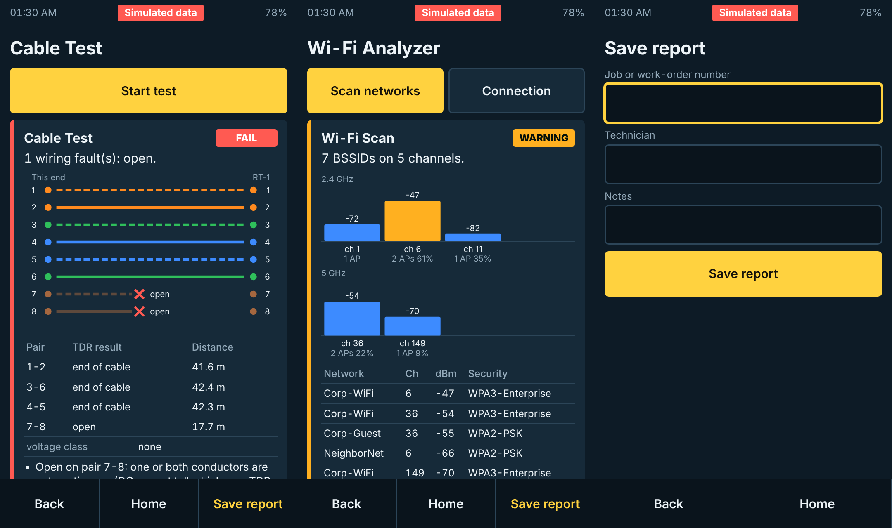

# NetScope X1

Handheld network diagnostic instrument for IT field technicians: cable wiremap and TDR, PoE analysis, wired network troubleshooting, Wi-Fi survey, one-button Auto Diagnose, and saved test reports.

**Status: v0.1.0, pre-hardware.** The diagnostic engine, touch UI, simulator and report export run today on a PC. The hardware is designed to block level with a checked block netlist, a BOM and an enclosure concept. **No schematic, PCB, coprocessor port or OS image exists, and nothing has been measured on hardware.** `docs/07-capability-matrix.md` states the status of every capability; read it literally.

## Try it (no hardware needed)

```
cd firmware
python -m venv .venv && . .venv/bin/activate        # Windows: .venv\Scripts\activate
pip install -e ".[dev]"
python -m netscope serve                             # open http://127.0.0.1:8080/
python -m netscope scenarios                         # 17 simulated situations
python -m netscope --scenario dns_fail run autodiag
pytest                                               # 108 tests
make -C coproc test                                  # coprocessor C core
```



Pick a scenario under Settings in the UI. Everything the simulator produces is labelled "Simulated data" on screen and in JSON, CSV and PDF exports.

## Architecture in brief

| Block | Choice |
|---|---|
| Processor | Raspberry Pi Compute Module 5 (Linux, on-module Wi-Fi/Bluetooth) |
| Safety / real-time | STM32G0B1 coprocessor: power, relays, wiremap front end, isolated PoE bus |
| Test port | LAN7801 + KSZ9131 PHY (TDR through `ethtool --cable-test`) |
| Wiremap | DC front end switched in by relays + RT-1 passive remote terminator |
| PoE | TPS2372-4 PD interface on an isolated island, INA228, switched load |
| UI | 5 inch 720x1280 touch panel + keypad; HTML UI in a kiosk browser over a local API |
| Battery | 1S3P 21700 pack, USB-C charging; about 10 h typical by calculation |

Why each was chosen, and what was rejected, is in `docs/02-architecture.md`.

## Repository map

| Path | Contents |
|---|---|
| `docs/` | 01 requirements and feasibility ... 15 dev-kit spike |
| `firmware/netscope/` | Engine: HAL, cable analysis, parsers, tools, Auto Diagnose, rules assistant, reports, API |
| `firmware/ui/` | Touch UI |
| `firmware/coproc/` | Coprocessor C core with host tests |
| `firmware/tests/` | Engine, parser, wiremap and API tests |
| `hardware/netlist/` | Block-level netlist (YAML) checked by `tools/check_netlist.py` |
| `hardware/bom/` | BOM with part-number status (known / candidate / tbd) |
| `hardware/kicad/` | Empty on purpose; see its README |
| `hardware/remote-terminator/` | RT-1 design |
| `mechanical/` | Parametric enclosure (CadQuery) with STEP, STL, 3MF and drawings |
| `tools/` | Netlist check, cost roll-up, power budget |

## What is and is not claimed

- Cable testing is continuity, wiremap and TDR **verification**. It is not TIA/ISO certification and the product must never be described that way.
- Cost and runtime figures are calculated estimates. Distributor prices were not checked line by line; 14 of 46 BOM parts are still "tbd".
- `firmware/netscope/hal/linux.py` (the real-network backend) has not been run against a network or a board.

## Next step

The dev-kit spike: `docs/15-dev-kit-spike.md` has the kit list, procedures and pass criteria. Budget $700-$900 and one to two weeks; it retires most of the technical risk before any schematic is drawn.

## License

Not yet chosen. All rights reserved by the project owner until a license file is added.
