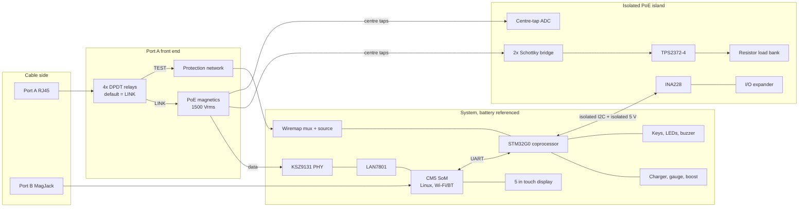

# 02 - Architecture

## Decisions in one page

| Question | Decision | Why |
|---|---|---|
| Main processor | Raspberry Pi Compute Module 5 (wireless) running Linux | Only candidate that gives gigabit Ethernet, pre-certified dual-band Wi-Fi + Bluetooth, DSI display and mainline-class drivers at this price, from U.S. distributors, with a stated production life to 2036 |
| Real-time / safety controller | STM32G0B1 coprocessor | Power sequencing, relays, wiremap front end and the isolated PoE bus must not depend on Linux being up or healthy |
| Test port Ethernet | LAN7801 (USB 3 MAC) + KSZ9131RNX PHY | The PHY has TDR cable diagnostics supported by mainline Linux `ethtool --cable-test`; the SoM's built-in PHY cannot be swapped and has no such support |
| Second port | SoM's native gigabit port through a MagJack | Free with the module; used for uplink, inline monitoring and two-ended throughput tests |
| Wiremap | Dedicated DC front end on the coprocessor, switched in by relays, plus the RT-1 passive remote | A PHY cannot see pin order, reversed pairs or which pins are shorted |
| PoE | TPS2372-4 PD interface on a galvanically isolated island, measured by INA228, loaded by a switched resistor bank | Standards-correct detection/classification up to 802.3bt Type 4; nothing network-powered touches the processor |
| Display | Raspberry Pi Touch Display 2, 5 inch, 720x1280 DSI | Driver ships with the SoM's kernel; $40; stated availability to 2030 |
| UI technology | Web UI (no framework) in a kiosk browser, served by the engine | One UI for device and desktop simulator; no cross-compiled UI toolchain. Cost: more RAM and slower boot than LVGL (see Trade-offs) |
| Engine language | Python 3 | The work is orchestration of sockets and tools, not computation; testable on any PC |
| Battery | 1S3P 21700 pack, about 54 Wh | Needed for 8 h on the typical profile (docs/06); under the 100 Wh air-transport threshold |

## Processor selection

Requirements that decide it: 10/100/1000 Ethernet on two ports, 2.4 + 5 GHz Wi-Fi scanning, Bluetooth, a 4-5 inch colour touch display, packet-level tools (DHCP, LLDP, capture, iperf3), PDF generation, and drivers that exist today.

| Platform | Gigabit Ethernet | 5 GHz Wi-Fi | Network tooling | Verdict |
|---|---|---|---|---|
| ESP32-S3 | No (10/100 via external PHY at best) | No, 2.4 GHz only | lwIP; no capture, no iperf3-class throughput | Rejected as main processor. Fails two hard requirements |
| STM32 (H7 class) | No on-chip gigabit MAC in the parts that are easy to buy; 10/100 typical | Needs a separate radio module and vendor stack | Would mean writing DHCP/LLDP/DNS/TLS/PDF/UI on an RTOS | Rejected as main processor; right tool for the coprocessor |
| Embedded Linux, custom SoC-down board (i.MX 8M, AM62, RK3568) | Yes, two native RGMII MACs possible | External module; radio certification is on us | Full Linux | Technically the cleanest (two RGMII ports, lower idle power) but DDR/PMIC layout, BSP maintenance and radio certification make it a poor first product |
| Embedded Linux SoM from an industrial vendor (i.MX 8M Plus / AM62 modules) | Yes, usually two | Usually on-module, certified | Full Linux, vendor BSP | Viable second source. Costs more per unit and the BSPs trail mainline. Keep as plan B (risk R-01) |
| **Raspberry Pi CM5 wireless** | One native port; second via USB 3 or PCIe | On-module, certified | Full Linux, large driver base, long support | **Selected** |

What CM5 costs us, stated plainly:

- **Power.** It idles higher than an i.MX/AM62 module. That is why the pack is three cells, not two.
- **No dependable suspend.** Standby means powering the SoM off and cold-booting.
- **Single source**, and its price rose during 2026.
- The second Ethernet port needs a bridge chip. USB 3 is close to but not a full gigabit in both directions under load; throughput figures on the test port must be characterised (risk R-04). The native port has no such limit.
- USB 3 signalling is a known source of 2.4 GHz interference: layout and shielding rules in docs/11.

## Block diagram



The machine-checkable version of this is `hardware/netlist/netscope-x1.yaml`.

## Safety and isolation

Three electrical domains are defined and enforced by `tools/check_netlist.py`:

- **LINE**: the eight conductors of the cable under test.
- **POE**: rectified network power and the parts that measure and load it.
- **SYS**: everything the user can touch, the processor and the battery.

Rules:

1. **Unpowered state is safe.** Relays are non-latching and rest in LINK: the cable sees only the isolation transformer. A dead battery or crashed firmware cannot leave the measurement front end on the cable.
2. **Network power never reaches SYS.** PoE is taken from the transformer centre taps into the POE island. The only links to SYS are a reinforced I2C isolator and an isolated DC/DC.
3. **Look before touching.** Port voltage is measured from the POE island (through the transformer, so still isolated) before anything else. Above 12 V the wiremap scan is refused; the coprocessor aborts a scan if voltage appears mid-scan (`firmware/coproc/wiremap.c`, host-tested).
4. **The one non-isolated moment** is a wiremap scan: relays move to TEST and the cable is connected, through PTC + pulse resistor + clamp on each line, to the SYS-referenced front end. This only happens on a cable already measured as unpowered. The protection network is sized to survive a passive 57 V injector being plugged in mid-scan until the relays drop. This needs a destructive-test proof in Phase 7 (test SAFE-03).
5. **Relays never switch under PoE load.** Firmware interlock: no relay change while the INA228 reads current.
6. **The load bank has a hardware over-temperature cut-off** independent of both processors.
7. **Passive / non-standard injectors**: bridges accept either polarity on either pair set; the 58 V TVS and 100 V-rated parts cover 24 V and 48-57 V passive systems. Passive voltages are reported and never loaded automatically.

Open safety items are tracked in docs/10 (R-02, R-06, R-07).

## Software stack

```
+--------------------------------------------------------------+
| Kiosk browser (cog / WPE WebKit)  ->  firmware/ui            |
+--------------------------------------------------------------+
| netscope engine (Python)                                     |
|   api/      HTTP API on 127.0.0.1                            |
|   engine/   tools, Auto Diagnose, rules assistant, cloud AI  |
|   cable/    wiremap analysis, RT-1 model                     |
|   net/      DHCP, DNS, LLDP, CDP, ethtool, iw parsers        |
|   reports/  JSON, CSV, PDF                                   |
|   hal/      sim | linux (+ coprocessor client)               |
+--------------------------------------------------------------+
| Linux: lan78xx + micrel PHY, brcmfmac, iproute2, ethtool,    |
|        iw, wpa_supplicant, iperf3, tcpdump, RAUC             |
+--------------------------------------------------------------+
| Coprocessor firmware (C): firmware/coproc                    |
+--------------------------------------------------------------+
```

The engine only talks to hardware through `hal/base.py`. The simulator and the real backend implement the same interface, and every result carries a `provenance` field (`simulated`, `host`, `hardware`) that is shown in the UI and printed on reports.

## Trade-offs worth revisiting

- **Web UI vs LVGL.** The kiosk browser costs roughly 250-400 MB of RAM and several seconds of boot. If cold-boot time or the 2 GB module becomes a problem, the API boundary lets the UI be replaced with an LVGL client without touching the engine.
- **USB 3 MAC vs PCIe.** PCIe would avoid the USB 3 / 2.4 GHz issue, but no PCIe MAC+PHY combination has mainline cable-test support. PCIe is kept free for an optional M.2 radio.
- **Resistor load vs electronic load.** Steps instead of a continuous sweep; in exchange there is no linear-MOSFET safe-operating-area risk and the INA228 measures the real power anyway.

## Sources checked for this document

- KSZ9131 cable-test support in mainline Linux: kernel commit "net: phy: micrel: ksz9031/ksz9131: add cabletest support", https://lore.kernel.org/r/20220407105534.85833-1-marex@denx.de
- TPS2372 (802.3bt Type 3/4 PD interface, autoclass, PSE type indicators): https://www.ti.com/product/TPS2372
- Compute Module 5 product brief (pricing, production life): https://www.raspberrypi.com/products/compute-module-5/
- Touch Display 2 (5 inch: resolution, active area, list price, production life): https://www.raspberrypi.com/products/touch-display-2/
