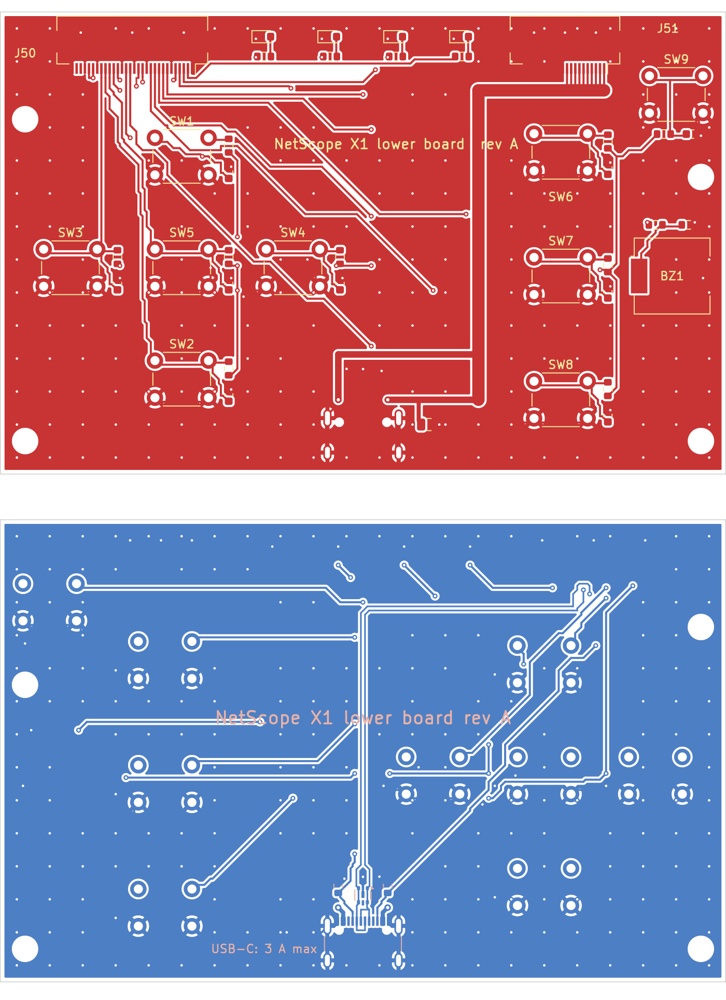

# KiCad projects

Three KiCad 9 projects, at three different levels of completeness. Read the status column before opening one.

| Project | Board | Status |
|---|---|---|
| `netscope-x1-lower/` | Lower board: keys, status LEDs, buzzer, USB-C | **Real capture, routed, rule-checked.** Gerbers exported. Not fabricated |
| `../remote-terminator/kicad/rt-1/` | RT-1 remote terminator | **Real capture, routed, rule-checked.** Gerbers exported. Not fabricated |
| `netscope-x1/` | Main board | **Five of nine sheets captured for real** (test-port Ethernet and uplink jack; processor module with display cable; coprocessor with the cables to the lower board; power; the optional microSD reader). The other four are block level. Board file: outline, placement guides, footprints of the captured sheets. Not routed |

## Why the main board is not at the same level yet

A pin-accurate main-board schematic cannot be completed honestly today, for three specific reasons:

1. **The fiber controller's pinout is not public.** Marvell publishes a product brief for the AQC100 and supplies the datasheet under NDA. Without it the fiber sheet cannot be captured. Either the datasheet is obtained through a distributor, or the design changes to a part or module with public documentation.
2. **Thirteen BOM lines are still "tbd"** (`../bom/bom.csv`), among them the PoE magnetics. A part that has not been chosen has no pins to draw.
3. **The bench kit has not been run** (`docs/15-dev-kit-spike.md`). It decides whether the test-port MAC/PHY pair and the fiber controller work at all on this platform.

Everything not blocked by those three can be captured now, sheet by sheet: the wiremap front end, Port A relays and jack, and the PoE measurement island. The coprocessor, power, processor, test-port and microSD sheets are done.

Routing is a separate limit. The lower board and the RT-1 were routed by script with the project's own grid router (`tools/gridrouter.py`), which is adequate for low-speed two-layer boards. It does no impedance control, length matching or differential-pair routing, so it is **not** adequate for the main board's 10 Gb serial link, PCIe, USB 3 and RGMII. Those need interactive layout by someone with the tools and experience for it.

## Lower board (`netscope-x1-lower/`)



88 x 56 mm, two layers, 49 parts. Nine tactile keys (Up, Down, Left, Right, OK, Back, Home, Fn, Power), each with a 10 k pull-up and 100 n; four status LEDs; a piezo buzzer; a USB-C receptacle on the back with ESD protection and CC pull-downs; two FFC connectors to the main board.

Checked by `python3 tools/check_lower.py` with KiCad 9.0.9:

- ERC: 0 violations, real library symbols.
- Every J50 / J51 pin carries the net in the pin table below.
- The cable nets map onto exactly the eight block-netlist nets that the floorplan says cross between the boards.
- Circuit rules: each key has its switch, pull-up and capacitor; each LED its series resistor; both CC pins 5.1 k to ground; both pads of each USB data line joined.
- DRC with schematic parity: 0 violations, 0 unconnected, 0 parity issues (643 track segments, 258 vias).

What is not verified, and what to know before ordering:

- **USB 2.0 impedance is not controlled.** On a two-layer 1.6 mm board the data pair is simply two 0.2 mm tracks side by side over a ground pour, about 70 mm long with roughly 4 mm of length difference. USB 2.0 high speed often works like this; it is untested here. If it does not, the fix is a four-layer version of this board.
- **3 A through the power cable** relies on ten 0.5 A contacts each way and a 1.5 mm trunk. Each pair of VBUS pads at the connector goes through a single 0.8 / 0.4 mm via.
- **D30 pin 5 is left open** deliberately, so the part does not clamp VBUS at 5 V. The data lines are still clamped by its internal diode. This follows common practice for this part, not a bench measurement.
- **Buzzer loudness** with direct 3.3 V drive is unmeasured, and the **LED resistor value** assumes LEDs with about 2 V forward drop.
- Footprints are KiCad's library footprints for the named parts; none was compared against the manufacturer's drawing here. The key switch is a generic 6 x 6 mm through-hole footprint with no specific part number chosen.
- Reference designators for small parts are on the fabrication layer, not the silkscreen.

### Cable pin assignments (the main board must mirror these)

J51, 20-way, power: pins 1-10 VBUS, pins 11-20 GND.

J50, 30-way, signals. Pin 1 is the end nearest the board centre.

| Pin | Net | Pin | Net | Pin | Net |
|---|---|---|---|---|---|
| 1 | GND | 11 | KEY_FN | 21 | KEY_OK |
| 2 | LED4 | 12 | GND | 22 | KEY_DOWN |
| 3 | LED3 | 13 | USB_DP | 23 | KEY_LEFT |
| 4 | LED2 | 14 | USB_DN | 24 | GND |
| 5 | LED1 | 15 | GND | 25 | +3V3_AON |
| 6 | GND | 16 | CC1 | 26 | +3V3_AON |
| 7 | KEY_PWR | 17 | CC2 | 27 | GND |
| 8 | KEY_BACK | 18 | GND | 28 | not connected |
| 9 | BUZZ | 19 | KEY_RIGHT | 29 | not connected |
| 10 | KEY_HOME | 20 | KEY_UP | 30 | GND |

Both connectors are Hirose FH12, 0.5 mm pitch. Whether the cable is same-side or opposite-side, and therefore whether pin 1 meets pin 1 or pin 30 on the main board, is decided when the main-board connectors are placed. It is not decided yet.

Files: `fab-rev-a/gerbers/` (Gerbers and drill), `fab-rev-a/lower-bom.csv`, `lower-placement.csv`, `lower-schematic.pdf`.

Regenerating: `python3 tools/gen_lower.py` (schematic), `python3 tools/layout_lower.py --force` (placement and routing, needs numpy), `python3 tools/check_lower.py --fab hardware/kicad/netscope-x1-lower/fab-rev-a`. Once the board is edited by hand in KiCad, stop running the layout script.

## Main board (`netscope-x1/`)

Open `netscope-x1/netscope-x1.kicad_pro`. The project mixes two kinds of sheet, and each sheet's title block says which it is.

**Captured for real: sheet 06, coprocessor** (`tools/main_sheets.py`). STM32G0B1CBU6 with its decoupling, bus pull-ups, hold-off pull-downs and series parts; the SWD pads; and the two cable connectors to the lower board. 24 parts with footprints. The pin plan is in [`coprocessor-pins.md`](coprocessor-pins.md).

What `tools/check_kicad.py` proves about that sheet: ERC is clean; every block net the block netlist gives U40 and J40 is implemented at pin level; all 20 pins that rely on a peripheral (ADC, UART, I2C, timers, SWD, wake-up) are on pins that have that function in KiCad's library symbol; every power and relay control has a 100 k hold-off resistor; and the cable pin tables equal the lower board's. Breaking the pin plan on purpose made the check fail.

What capturing it changed in the design:

- **The coprocessor is now the 48-pin QFN (STM32G0B1CBU6), not the LQFP.** The LQFP is 1.6 mm tall and the front of the main board has 1.5 mm. All 43 I/O pins are used but one, which is on a test pad.
- **The SFP status and transmit-disable lines moved from the coprocessor to the SoM.** The coprocessor had run out of pins, and Linux's SFP driver expects those lines on the host anyway. The coprocessor keeps only the SFP power enable.
- **The cable connectors are on the back of the main board.** FH12 connectors are 2.0 mm tall, too tall for the front. Their actuators overhang the bottom edge by 0.9 mm.
- The debug header became Tag-Connect pads for SWD (J40) plus separate test pads for the SoM console and boot (J41, still block level).

Open points on this sheet:

- **The signal cable does not line up.** J50 is at x = -5.5 mm on the main board and x = -28 mm on the lower board, because the main board's back is occupied there by the PoE supply and the lower board's top edge is occupied by the LED row. It needs a cable with a sideways jog (folded FFC or a small custom flex) or a floorplan change. The power cable does line up.
- **Cable pin order** (pin n to pin n, contacts on opposite faces) is worked out from the placement, not confirmed with parts.
- **Boot entry for firmware updates from the SoM** depends on the MCU's option bits, and the behaviour of the two UCPD dead-battery pins used as outputs has not been checked against the reference manual.
- The 17 nets that leave this sheet for sheets not yet captured are listed by the checker as open interfaces.

**Captured for real: sheet 07, power** (`tools/main_sheets.py`). BQ25895 charger and power path, MAX17055 fuel gauge with a 5 mOhm sense resistor, TPS61088 5.1 V boost, TPS62840 always-on 3.3 V, TLV62569 3.3 V. 49 parts.

Where the pins come from: the charger and the TLV62569 use KiCad's library symbols. The boost converter, the always-on buck and the fuel gauge have no library symbol, so their symbols are plain boxes whose pin numbers were taken from the manufacturers' data sheets (TI SLVSCM8, TI SLVSEC6, the MAX17055 data sheet) as extracted text. **Those three pin tables must be compared with the PDFs by eye before a board is ordered.**

This sheet is not buildable yet. The checker lists what is open and fails if that list changes without the schematic changing with it:

- **R68 and C76, the boost converter's loop compensation, have no values.** The data sheet's worked example is for 9 V out, and the procedure has to be run for 5.1 V.
- **U51 (fuel gauge) has no footprint**: KiCad's library has none for its 2 x 2.5 mm 10-pin TDFN.
- **BT1 (battery connection) has no footprint**: connector or solder pads are decided with the pack supplier.

Other values are data-sheet starting points, not a verified design: the boost frequency resistor (my reading of the data sheet equation, about 600 kHz), the charger's thermistor divider (data sheet values for a 103AT part; the pack's NTC is not known), inductors (candidates by rating and footprint, not confirmed in stock).

Design decisions made on this sheet, each a change from the block netlist or a risk:

- **The sense resistor is 5 mOhm, not the gauge data sheet's 10.** The boost can pull more than 7 A from the pack and 10 mOhm only measures to 5.1 A.
- **The fuel gauge has its own board thermistor.** The pack's NTC goes to the charger only; two bias networks cannot share one thermistor.
- **The charger's D+/D- pins sit directly on the USB data pair, in parallel with the SoM**, without the analogue switch TI's DSEL pin is meant to drive. It may disturb USB data or charger detection; this needs a bench test.
- Battery negative reaches ground only through the sense resistor, so the pack's negative lead must not touch chassis or any other ground.

**Captured for real: sheet 05, processor** (`tools/main_sheets.py`). The Compute Module 5 as one 200-pin symbol, its supply capacitors, the 22-way display cable connector, the display's 5 V lead and the debug pads. 112 of the module's 200 pins are connected; the other 88 carry explicit no-connect marks.

The module's pin names come from the pinout table in Raspberry Pi's CM5 data sheet, read as text. About 80 of the 200 were cross-checked against two other published pin lists and agreed. The checker confirms that every planned connection is on the intended pin, and that each of the 15 differential pairs has its positive and negative halves on the matching halves of one module signal.

Open on this sheet:

- **M1 has no footprint.** It is two Hirose DF40C-100DS-0.4V receptacles and four mounting holes at an exact spacing; that should be taken from Raspberry Pi's published design files, not re-drawn from a dimension read off a PDF. KiCad's library does have the single receptacle.
- **J2 (display 5 V lead) has no footprint**: it depends on the lead supplied with the display.
- **Written from memory, to be verified before layout:** the 22-way display pin order; that touch I2C belongs on SCL0/SDA0 for this display port; and which GPIO pairs carry UART0 and UART2.
- Closed from the CM5 data sheet: the RTC input accepts 2.5 to 3.5 V, so the always-on 3.3 V rail is within range; GPIO2/3 already have 1.8 k pull-ups on the module, so the two SFP bus pull-ups (R81, R82) were removed.
- GPIO6 now drives LAN_NRST, the reset of the test port's USB Ethernet bridge (new block net).
- The display connector is a 1 mm-class Amphenol part chosen because the front of the board has 1.5 mm; its exact part number, height and contact side are candidates.

**Captured for real: sheet 02, test-port Ethernet and uplink jack** (`tools/main_sheets.py`). LAN7801 USB 3 to RGMII bridge (U11) on the module's USB 3 port 0, KSZ9131RNX gigabit PHY (U10) whose MDI pairs go to the Port A magnetics on sheet 01, two TVS arrays on those pairs (D10, D11), a 1.2 V buck for the PHY core (U12), two 25 MHz crystals, and the uplink MagJack (J11) on the module's own Ethernet. 97 parts.

The two Microchip parts have no KiCad symbol; their box symbols carry pin numbers from the data sheets read as text, to be compared with the PDFs by eye. Support parts follow Microchip's LAN7801 schematic checklist (supply decoupling, 3.3 uH / 22 uF for the internal 1.2 V switcher, ferrite-fed analogue 1.2 V, 12.0 k USB bias, 2.00 k and 1.0 uF references, 1.5 k MDIO pull-up, 10 k JTAG pull-ups, TEST to ground, pin 34 left open, DUPLEX tied high). The PHY straps are external 10 k resistors because the data sheet says the straps have no internal resistors: MODE 1110 (RGMII, advertise 1000 full and 10/100), PHY address 001, no 125 MHz output.

Design decisions made on this sheet:

- **USB 3 coupling capacitors only on the bridge's transmit pair.** The CM5 data sheet says the module already has them on its own transmit pair.
- **RGMII delays come from the PHY**, not from trace length: the Linux lan78xx driver asks the PHY driver for internal delays and turns off its own.
- **The PHY core gets its own buck (U12, 3.3 V to 1.2 V)** instead of the PHY's LDO controller with an external transistor: the core draws 220 mA at 1000BASE-T, which would put about 0.45 W in a linear pass transistor. Its enable is delayed by an R/C so the core comes up after 3.3 V, as the data sheet recommends.
- **The bridge's reset is on a module GPIO** (pulled up, so it starts on its own), because the checklist recommends a hardware reset and advises against an R/C reset.
- **The uplink jack is the UDE RB1-125B8G1A** (gigabit, LEDs, about 16 x 22 mm, KiCad symbol and footprint). The first pick, Pulse JK0654219NL, is 33 mm deep and does not fit the 21.5 mm slot. The floorplan moved J11 so its LED pins clear the board edge (front 4 mm past the edge instead of 6.5 mm), and U54 moved 2 mm to make room.
- **The uplink jack's shield is on system ground, not the floating CHASSIS net.** DRC showed why: the jack's internal 2 kV termination capacitor returns on pin R10, which the maker placed 0.64 mm from the PHY-side pins, so the jack is designed for that pin to be at board ground. The uplink is an ordinary LAN port, like a laptop's; the floating chassis stays on the test port (J10) only.
- D10 became two parts (D10, D11) in the block netlist, one TPD4E05U06 per two pairs.

Open on this sheet (the checker lists the footprint items):

- **Footprints to confirm:** the exposed-pad sizes of U11 (64-SQFN 9 x 9) and U10 (48-QFN 7 x 7) were not in the data sheet text; KiCad footprints with 7.15 mm and 5.6 mm pads are placeholders. J11's LED anode/cathode pins come from the KiCad symbol's drawing, as the maker's spec text gives no polarity.
- **Starting values, not from a Microchip document:** RGMII series resistors (10 R), the PHY's decoupling, crystal load capacitors (15 pF for a 10 pF-load crystal with about 3 pF stray).
- **Assumed:** the ALLPHYAD strap's polarity (pull-up = 1, by analogy with the other straps).
- **Bench checks:** the PHY needs 10 ms of stable supply before its reset is released, and the release comes from the bridge; no EEPROM, so the test port's MAC address is set by software.
- The Port A magnetics (T1, sheet 01) need a 100 nF capacitor per centre tap for the KSZ9131, to be drawn when sheet 01 is captured.
- **Housing:** J11's front now sits 2.5 mm behind the inside of the top end wall (it was flush), so the plug passes through about 8 mm of wall and bumper. Check a booted plug in the printed housing; if it binds, move the board or deepen the opening. J10 should line up with J11 when sheet 01 is captured.

**Captured for real: sheet 09, microSD reader (option)** (`tools/main_sheets.py`). USB2244 card reader (U60) on the module's second USB 2.0 pair, 24 MHz crystal, Hirose DM3AT push-push socket (J30), and the support parts from Microchip's USB2244 hardware design checklist (0.1 uF per 3.3 V pin, 1 uF on each internal 1.8 V output, 12.0 k bias, 1 M across the crystal, 4.7 uF on card power, 10 k / 1 uF reset, pull-down on write-protect so cards can be written). 20 parts, **all marked DNP**: the reader is not fitted on rev A, but its footprints are on the board.

- **The block netlist had U60 on +5V; it is on +3V3 now.** The chip runs from 3.3 V and makes its own 1.8 V.
- **The data sheet contradicts itself on pins 23-26** (its pin diagram against its two pin tables). The sheet follows the tables; the checker lists U60 as a pin table to confirm, together with its exposed-pad size.
- No configuration EEPROM; SDA/SCK are pulled up so a probe for one sees an idle bus. That is an assumption, the checklist is silent.
- The board's microSD tab is now 17 mm wide (was 15): the socket's pads need 0.5 mm to the edge. In the housing, the card's end sits about 6 mm inside the outer face of wall and bumper, which a push-push card needs reaching with a fingertip or tool: to be tried on a printed housing.

The old processor sheet was split so this could be captured: the fiber port (U70, J32) and the optional microSD reader (U60, J30) are now their own block sheets, 08 and 09.

**Block level: the other four sheets.**

On those sheets the project is a block diagram in KiCad form, not schematic capture. It puts the checked block netlist into KiCad so that capture can go sheet by sheet in a project that already has the reference designators, net names, electrical domains and isolation rules in place. Nothing in the main-board project can be sent to a fabricator.

## What is in it

| File | What it is | How it was made |
|---|---|---|
| `netscope-x1.kicad_sch` + `01_…` to `09_….kicad_sch` | Root sheet and nine hierarchical sheets: five captured for real (203 parts with real pins and footprints, except the open items above) and four block level (26 parts) | Generated by `tools/gen_kicad.py`: block sheets from `../netlist/netscope-x1.yaml`, captured sheets from the builders in `tools/main_sheets.py` |
| `netscope-x1.kicad_sym` | Project-local library: block symbols, plus box symbols with data-sheet pin numbers for parts KiCad's library lacks | Generated |
| `netscope-x1.kicad_pro` | Project settings. Net classes `LINE`, `POE`, `SYS` and one assignment per net | Net-class section generated; everything else is KiCad's and is kept on regeneration |
| `netscope-x1.kicad_dru` | Custom rules: 2.5 mm between nets of different domains | Generated from `rules.isolation` in `../pcb/floorplan.yaml` |
| `netscope-x1.kicad_pcb` | Outline (88 x 88 mm plus microSD tab), mounting holes, a labelled rectangle for every block-level part, and the real footprints of the captured sheets: those with a floorplan position are placed there, the rest are parked beside the board | `tools/seed_kicad_pcb.py --force`, re-run after each capture while the board is unrouted |

## What was checked, and with what

Run `python tools/check_kicad.py` (needs KiCad 9 on the path). With KiCad 9.0.9 it reports:

- **ERC:** 10 sheets, 0 violations at every severity. 31 nets end at a block sheet that is not captured yet; only nets explained by the block netlist are accepted as such.
- **Block sheets:** KiCad's netlist equals the YAML netlist for the 26 block-level parts, pin for pin.
- **Captured sheets:** every block net of every captured part is implemented at pin level, and no part touches a block net the block netlist does not give it (exceptions are listed with a reason); coprocessor pin functions against the library's alternate-function list; module pins and the polarity of 15 differential pairs; hold-off resistors; both cable pin tables; and the open items (parts without footprints, footprints or pin tables to confirm, values not chosen) must match the lists in `tools/main_sheets.py`.
- **Net classes:** every net carries the class of its domain, sheet by sheet (347 assignments).
- **DRC on the board file:** 0 violations, besides the cable connectors' accepted edge overhang and silkscreen warnings left for layout. The board is not routed: open connections are counted, not failed.
- **Isolation rules:** on a scratch board, a 1.0 mm gap between LINE and SYS, POE and SYS, and LINE and POE tracks is flagged by the matching rule, and two LINE tracks 0.4 mm apart are not.

The checker was itself tested by breaking things on purpose: a mis-named label fails the netlist comparison, a moved MCU pin fails the pin-function check, and a rules file with a syntax error fails the isolation probe (`kicad-cli` ignores a rules file it cannot parse without saying so, which is why the probe exists).

## What a pass does not mean

- **Block sheets are function-level.** Their pins stand for functions, often several signals each, and carry placeholder numbers.
- **Data-sheet pin tables were read as text.** The box symbols for parts without a KiCad symbol (TPS61088, TPS62840, MAX17055, CM5, LAN7801, KSZ9131RNX, USB2244) must be compared with the PDFs by eye.
- **ERC only sees pin types.** It cannot catch a wrong voltage, a wrong value or a misread data sheet.
- **The board is not laid out.** Footprints of captured sheets are placed or parked, nothing is routed, and the 6-layer stack-up is KiCad's default, not the one in `docs/11-pcb-design-guide.md`.
- **2.5 mm is a design value**, not a safety rating. Creepage and clearance across the PoE barrier need a review against the applicable standard before layout.
- The lower board's parts still appear on the block sheets, because the block netlist covers the whole instrument. Their real schematic is the lower-board project above.

## How to capture the next sheet

1. Write a builder in `tools/main_sheets.py`: real symbols (KiCad library, or `box_symbol` with pin numbers from the data sheet), every pin given a net or an explicit no-connect, footprints, and the application circuit.
2. Declare in `REFINES` how each pin-level net implements a block net (or is local), and list anything not yet decided in `NO_FOOTPRINT`, `OPEN_VALUES` or `TO_CONFIRM`.
3. Register the sheet in `CAPTURED`, run `tools/gen_kicad.py`, `tools/seed_kicad_pcb.py --force`, `tools/gen_kicad.py` again, then `tools/check_kicad.py`.
4. Fix what the checker and DRC find in the design, not in the checker.

## Regenerating

```
python tools/gen_kicad.py          # schematic sheets, symbol library, net classes, rules file
python tools/check_kicad.py        # ERC, netlist comparison, net classes, DRC, isolation probe
python3 tools/seed_kicad_pcb.py --force   # board file (only while it is unrouted)
```

Edit the YAML netlist and `tools/main_sheets.py`, not the generated sheets. CI regenerates the schematic and fails if the committed files differ, then runs the checker.

Conventions kept from the block netlist: KiCad 9 or later; one hierarchical sheet per block; project-local libraries committed to the repository; reference designators and net names as in the netlist.
