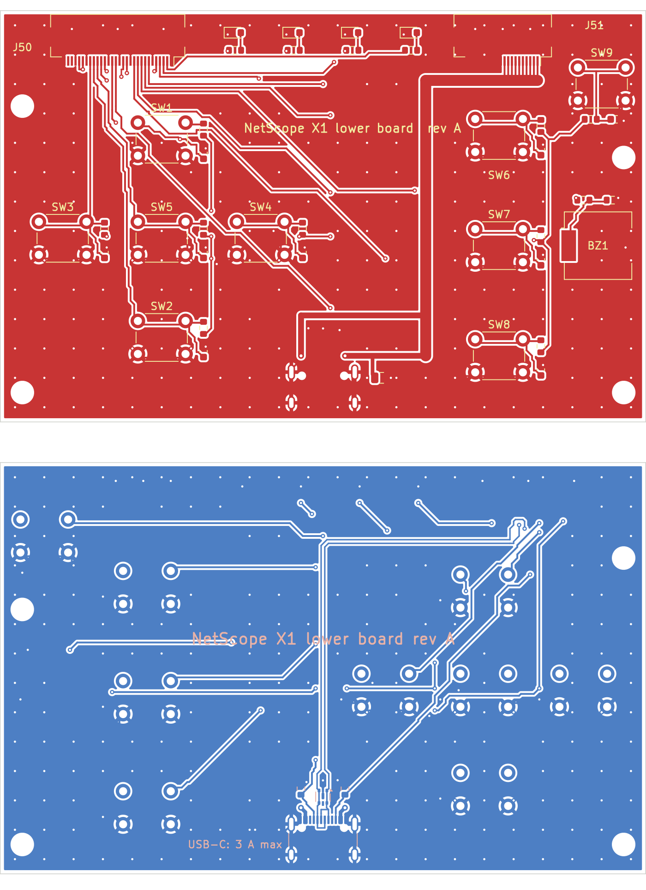

# KiCad projects

Three KiCad 9 projects, at three different levels of completeness. Read the status column before opening one.

| Project | Board | Status |
|---|---|---|
| `netscope-x1-lower/` | Lower board: keys, status LEDs, buzzer, USB-C | **Real capture, routed, rule-checked.** Gerbers exported. Not fabricated |
| `../remote-terminator/kicad/rt-1/` | RT-1 remote terminator | **Real capture, routed, rule-checked.** Gerbers exported. Not fabricated |
| `netscope-x1/` | Main board | **Two of seven sheets captured for real** (coprocessor with the cables to the lower board; power). The other five are block level. Board file: outline, placement guides, footprints of the captured sheets. Not routed |

## Why the main board is not at the same level yet

A pin-accurate main-board schematic cannot be completed honestly today, for three specific reasons:

1. **The fiber controller's pinout is not public.** Marvell publishes a product brief for the AQC100 and supplies the datasheet under NDA. Without it the fiber sheet cannot be captured. Either the datasheet is obtained through a distributor, or the design changes to a part or module with public documentation.
2. **Fourteen BOM lines are still "tbd"** (`../bom/bom.csv`), among them the PoE magnetics. A part that has not been chosen has no pins to draw.
3. **The bench kit has not been run** (`docs/15-dev-kit-spike.md`). It decides whether the test-port MAC/PHY pair and the fiber controller work at all on this platform.

Everything not blocked by those three can be captured now, sheet by sheet: coprocessor, power, wiremap front end, Port A relays and jack, the PoE measurement island and the board-to-board connectors.

Routing is a separate limit. The lower board and the RT-1 were routed by script with the project's own grid router (`tools/gridrouter.py`), which is adequate for low-speed two-layer boards. It does no impedance control, length matching or differential-pair routing, so it is **not** adequate for the main board's 10 Gb serial link, PCIe, USB 3 and RGMII. Those need interactive layout by someone with the tools and experience for it.

## Lower board (`netscope-x1-lower/`)



88 x 56 mm, two layers, 49 parts. Nine tactile keys (Up, Down, Left, Right, OK, Back, Home, Fn, Power), each with a 10 k pull-up and 100 n; four status LEDs; a piezo buzzer; a USB-C receptacle on the back with ESD protection and CC pull-downs; two FFC connectors to the main board.

Checked by `python3 tools/check_lower.py` with KiCad 9.0.9:

- ERC: 0 violations, real library symbols.
- Every J50 / J51 pin carries the net in the pin table below.
- The cable nets map onto exactly the eight block-netlist nets that the floorplan says cross between the boards.
- Circuit rules: each key has its switch, pull-up and capacitor; each LED its series resistor; both CC pins 5.1 k to ground; both pads of each USB data line joined.
- DRC with schematic parity: 0 violations, 0 unconnected, 0 parity issues (643 track segments, 258 vias).

What is not verified, and what to know before ordering:

- **USB 2.0 impedance is not controlled.** On a two-layer 1.6 mm board the data pair is simply two 0.2 mm tracks side by side over a ground pour, about 70 mm long with roughly 4 mm of length difference. USB 2.0 high speed often works like this; it is untested here. If it does not, the fix is a four-layer version of this board.
- **3 A through the power cable** relies on ten 0.5 A contacts each way and a 1.5 mm trunk. Each pair of VBUS pads at the connector goes through a single 0.8 / 0.4 mm via.
- **D30 pin 5 is left open** deliberately, so the part does not clamp VBUS at 5 V. The data lines are still clamped by its internal diode. This follows common practice for this part, not a bench measurement.
- **Buzzer loudness** with direct 3.3 V drive is unmeasured, and the **LED resistor value** assumes LEDs with about 2 V forward drop.
- Footprints are KiCad's library footprints for the named parts; none was compared against the manufacturer's drawing here. The key switch is a generic 6 x 6 mm through-hole footprint with no specific part number chosen.
- Reference designators for small parts are on the fabrication layer, not the silkscreen.

### Cable pin assignments (the main board must mirror these)

J51, 20-way, power: pins 1-10 VBUS, pins 11-20 GND.

J50, 30-way, signals. Pin 1 is the end nearest the board centre.

| Pin | Net | Pin | Net | Pin | Net |
|---|---|---|---|---|---|
| 1 | GND | 11 | KEY_FN | 21 | KEY_OK |
| 2 | LED4 | 12 | GND | 22 | KEY_DOWN |
| 3 | LED3 | 13 | USB_DP | 23 | KEY_LEFT |
| 4 | LED2 | 14 | USB_DN | 24 | GND |
| 5 | LED1 | 15 | GND | 25 | +3V3_AON |
| 6 | GND | 16 | CC1 | 26 | +3V3_AON |
| 7 | KEY_PWR | 17 | CC2 | 27 | GND |
| 8 | KEY_BACK | 18 | GND | 28 | not connected |
| 9 | BUZZ | 19 | KEY_RIGHT | 29 | not connected |
| 10 | KEY_HOME | 20 | KEY_UP | 30 | GND |

Both connectors are Hirose FH12, 0.5 mm pitch. Whether the cable is same-side or opposite-side, and therefore whether pin 1 meets pin 1 or pin 30 on the main board, is decided when the main-board connectors are placed. It is not decided yet.

Files: `fab-rev-a/gerbers/` (Gerbers and drill), `fab-rev-a/lower-bom.csv`, `lower-placement.csv`, `lower-schematic.pdf`.

Regenerating: `python3 tools/gen_lower.py` (schematic), `python3 tools/layout_lower.py --force` (placement and routing, needs numpy), `python3 tools/check_lower.py --fab hardware/kicad/netscope-x1-lower/fab-rev-a`. Once the board is edited by hand in KiCad, stop running the layout script.

## Main board (`netscope-x1/`)

Open `netscope-x1/netscope-x1.kicad_pro`. The project mixes two kinds of sheet, and each sheet's title block says which it is.

**Captured for real: sheet 06, coprocessor** (`tools/main_sheets.py`). STM32G0B1CBU6 with its decoupling, bus pull-ups, hold-off pull-downs and series parts; the SWD pads; and the two cable connectors to the lower board. 24 parts with footprints. The pin plan is in [`coprocessor-pins.md`](coprocessor-pins.md).

What `tools/check_kicad.py` proves about that sheet: ERC is clean; every block net the block netlist gives U40 and J40 is implemented at pin level; all 20 pins that rely on a peripheral (ADC, UART, I2C, timers, SWD, wake-up) are on pins that have that function in KiCad's library symbol; every power and relay control has a 100 k hold-off resistor; and the cable pin tables equal the lower board's. Breaking the pin plan on purpose made the check fail.

What capturing it changed in the design:

- **The coprocessor is now the 48-pin QFN (STM32G0B1CBU6), not the LQFP.** The LQFP is 1.6 mm tall and the front of the main board has 1.5 mm. All 43 I/O pins are used but one, which is on a test pad.
- **The SFP status and transmit-disable lines moved from the coprocessor to the SoM.** The coprocessor had run out of pins, and Linux's SFP driver expects those lines on the host anyway. The coprocessor keeps only the SFP power enable.
- **The cable connectors are on the back of the main board.** FH12 connectors are 2.0 mm tall, too tall for the front. Their actuators overhang the bottom edge by 0.9 mm.
- The debug header became Tag-Connect pads for SWD (J40) plus separate test pads for the SoM console and boot (J41, still block level).

Open points on this sheet:

- **The signal cable does not line up.** J50 is at x = -5.5 mm on the main board and x = -28 mm on the lower board, because the main board's back is occupied there by the PoE supply and the lower board's top edge is occupied by the LED row. It needs a cable with a sideways jog (folded FFC or a small custom flex) or a floorplan change. The power cable does line up.
- **Cable pin order** (pin n to pin n, contacts on opposite faces) is worked out from the placement, not confirmed with parts.
- **Boot entry for firmware updates from the SoM** depends on the MCU's option bits, and the behaviour of the two UCPD dead-battery pins used as outputs has not been checked against the reference manual.
- The 17 nets that leave this sheet for sheets not yet captured are listed by the checker as open interfaces.

**Captured for real: sheet 07, power** (`tools/main_sheets.py`). BQ25895 charger and power path, MAX17055 fuel gauge with a 5 mOhm sense resistor, TPS61088 5.1 V boost, TPS62840 always-on 3.3 V, TLV62569 3.3 V. 49 parts.

Where the pins come from: the charger and the TLV62569 use KiCad's library symbols. The boost converter, the always-on buck and the fuel gauge have no library symbol, so their symbols are plain boxes whose pin numbers were taken from the manufacturers' data sheets (TI SLVSCM8, TI SLVSEC6, the MAX17055 data sheet) as extracted text. **Those three pin tables must be compared with the PDFs by eye before a board is ordered.**

This sheet is not buildable yet. The checker lists what is open and fails if that list changes without the schematic changing with it:

- **R68 and C76, the boost converter's loop compensation, have no values.** The data sheet's worked example is for 9 V out, and the procedure has to be run for 5.1 V.
- **U51 (fuel gauge) has no footprint**: KiCad's library has none for its 2 x 2.5 mm 10-pin TDFN.
- **BT1 (battery connection) has no footprint**: connector or solder pads are decided with the pack supplier.

Other values are data-sheet starting points, not a verified design: the boost frequency resistor (my reading of the data sheet equation, about 600 kHz), the charger's thermistor divider (data sheet values for a 103AT part; the pack's NTC is not known), inductors (candidates by rating and footprint, not confirmed in stock).

Design decisions made on this sheet, each a change from the block netlist or a risk:

- **The sense resistor is 5 mOhm, not the gauge data sheet's 10.** The boost can pull more than 7 A from the pack and 10 mOhm only measures to 5.1 A.
- **The fuel gauge has its own board thermistor.** The pack's NTC goes to the charger only; two bias networks cannot share one thermistor.
- **The charger's D+/D- pins sit directly on the USB data pair, in parallel with the SoM**, without the analogue switch TI's DSEL pin is meant to drive. It may disturb USB data or charger detection; this needs a bench test.
- Battery negative reaches ground only through the sense resistor, so the pack's negative lead must not touch chassis or any other ground.

**Block level: the other five sheets.**

On those sheets the project is a block diagram in KiCad form, not schematic capture. It puts the checked block netlist into KiCad so that capture can go sheet by sheet in a project that already has the reference designators, net names, electrical domains and isolation rules in place. Nothing in the main-board project can be sent to a fabricator.

## What is in it

| File | What it is | How it was made |
|---|---|---|
| `netscope-x1.kicad_sch` + `01_…` to `07_….kicad_sch` | Root sheet and seven hierarchical sheets, 47 parts, 100 nets | Generated by `tools/gen_kicad.py` from `../netlist/netscope-x1.yaml` |
| `netscope-x1.kicad_sym` | Project-local library, one block symbol per part | Generated |
| `netscope-x1.kicad_pro` | Project settings. Net classes `LINE`, `POE`, `SYS` and one assignment per net | Net-class section generated; everything else is KiCad's and is kept on regeneration |
| `netscope-x1.kicad_dru` | Custom rules: 2.5 mm between nets of different domains | Generated from `rules.isolation` in `../pcb/floorplan.yaml` |
| `netscope-x1.kicad_pcb` | Board outline (88 x 88 mm plus microSD tab), four M2.5 mounting holes, and every floorplan part as a labelled rectangle on `Dwgs.User` (front) or `Cmts.User` (back) | Seeded once by `tools/seed_kicad_pcb.py` with KiCad's own Python API; edited by hand from here on |
| `../netscope-x1-kicad-schematic.pdf` | The eight sheets as KiCad plots them | `kicad-cli sch export pdf` |

## What was checked, and with what

Run `python tools/check_kicad.py` (needs KiCad 9 on the path). With KiCad 9.0.9 it reports:

- **ERC:** 8 sheets, 0 violations at every severity.
- **Netlist:** KiCad's exported netlist has the same 47 parts, 100 nets and 300 pins as the YAML netlist, pin for pin.
- **Net classes:** every net carries the class of its domain (156 net-on-sheet assignments).
- **DRC on the board file:** 0 violations. This covers the outline and the mounting holes only.
- **Isolation rules:** on a scratch board, a 1.0 mm gap between LINE and SYS, POE and SYS, and LINE and POE tracks is flagged by the matching rule, and two LINE tracks 0.4 mm apart are not.

The checker was itself tested by breaking things on purpose: a mis-named label fails the netlist comparison, and a rules file with a syntax error fails the isolation probe (`kicad-cli` ignores a rules file it cannot parse without saying so, which is why the probe exists).

## What a pass does not mean

- **Pins are functions, not package pins.** `U10.RGMII` is one pin standing for twelve signals. Pin numbers are placeholders (1, 2, 3 … in netlist order). No symbol has been compared with a datasheet.
- **ERC is weak here.** It only sees the pin types the generator assigned: the declared source of a supply net is a power output, its loads are power inputs, everything else is passive. It proves each supply net has exactly one declared source and nothing is left unconnected. It cannot catch a wrong voltage, a swapped pair or a missing pull-up.
- **No footprints** are assigned, so there is nothing to place or route, and schematic-to-board parity is not checked.
- **No application circuits.** Decoupling, straps, crystals' load capacitors, compensation networks, pull-ups, test points and ESD parts beyond the block-level ones are absent.
- **The board file is an outline with guides.** The rectangles are approximate part envelopes from the floorplan. The 6-layer stack-up is KiCad's default, not the one in `docs/11-pcb-design-guide.md`.
- **2.5 mm is a design value**, not a safety rating. Creepage and clearance across the PoE barrier need a review against the applicable standard before layout.
- The lower board's parts still appear on these block sheets, because the block netlist covers the whole instrument. Their real schematic is the lower-board project above.

## How to go from here to real capture

Work one sheet at a time, only after the bench kit in `docs/15-dev-kit-spike.md` has confirmed the part choices on that sheet:

1. Replace each block symbol with the real part's symbol (KiCad library or drawn from the datasheet), keeping the reference designator.
2. Split bundle nets into real signals (`A_MDI_A` into `A_MDI_A_P` / `A_MDI_A_N`, `RGMII` into its twelve lines) and add the application circuit from the datasheet.
3. Assign footprints, then check each against the manufacturer's land pattern.
4. From that point the sheet is hand-maintained. Stop regenerating it: `tools/gen_kicad.py` overwrites the schematic sheets and the symbol library. Keep `tools/check_netlist.py` rules true by exporting KiCad's netlist and checking domains and barriers against it.

## Regenerating

```
python tools/gen_kicad.py          # schematic sheets, symbol library, net classes, rules file
python tools/check_kicad.py        # ERC, netlist comparison, net classes, DRC, isolation probe
python3 tools/seed_kicad_pcb.py    # board file; refuses to overwrite without --force
```

Edit the YAML netlist, not the generated sheets. CI regenerates the schematic and fails if the committed files differ, then runs the checker.

Conventions kept from the block netlist: KiCad 9 or later; one hierarchical sheet per block; project-local libraries committed to the repository; reference designators and net names as in the netlist.
