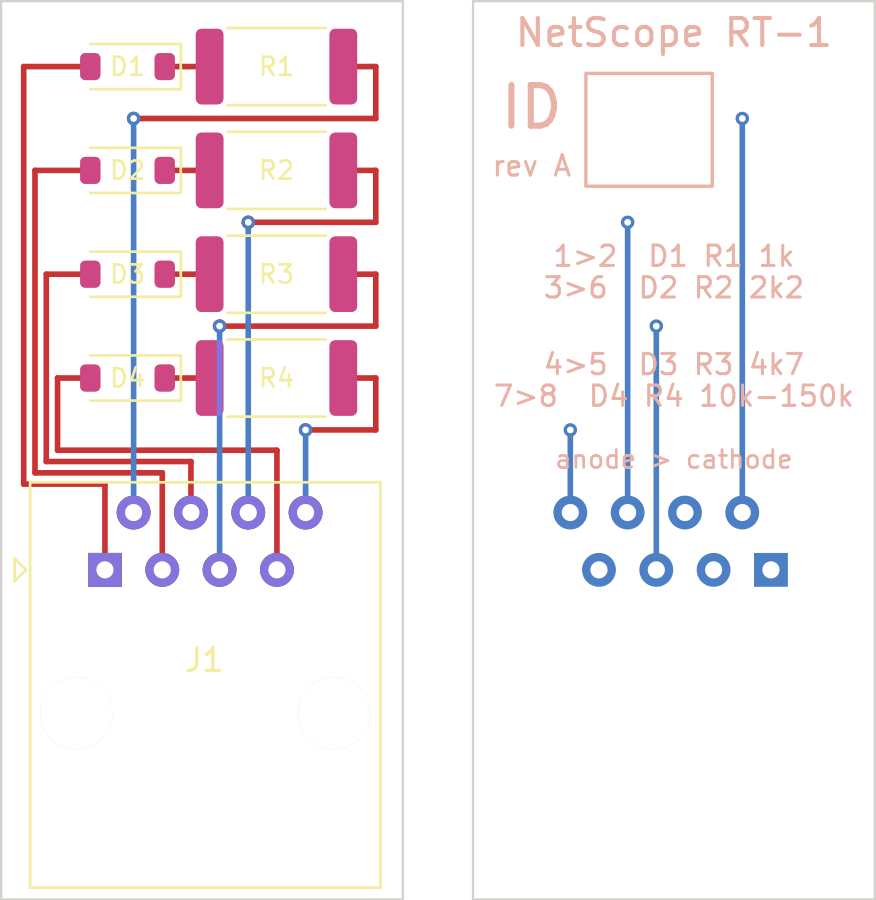

# RT-1 remote terminator

Passive plug-in terminator for wiremap, cable ID and length. Electrical definition: `docs/03-cable-test.md` and `firmware/netscope/cable/terminator.py` (the firmware file wins if they ever differ; the schematic here is generated from it).

**Status: rev A, designed and rule-checked, not fabricated, not measured.** This is the first board in the project that is real schematic capture and a routed layout, and it is the terminator the bench plan needs (`docs/15-dev-kit-spike.md`, step 4).



| Element | Between pins (anode -> cathode) | Value |
|---|---|---|
| D1 + R1 | 1 -> 2 | 1.0 k, 1 % |
| D2 + R2 | 3 -> 6 | 2.2 k, 1 % |
| D3 + R3 | 4 -> 5 | 4.7 k, 1 % |
| D4 + R4 | 7 -> 8 | ID: 10 k / 15 k / 22 k / 33 k / 47 k / 68 k / 100 k / 150 k for #1-#8 |

## The board

- 17.8 x 39.8 mm, two layers, 1.6 mm. Nine parts, all on the front. 0.25 mm tracks, 0.6 / 0.3 mm vias, 0.2 mm minimum clearance: any low-cost fab's standard service.
- J1 is an unshielded RJ45 **jack** (Amphenol 54602-908LF, active, about $0.50-$1). Connect it with a short patch lead; at a wall outlet the lead goes from the outlet to the RT-1. A jack was chosen over a board-mounted plug because the jack is a stock part.
- D1-D4: 1N4148W, SOD-123 (75 V reverse, any maker).
- R1-R4: 1 %, **2512** footprint. Larger than the measurement needs; see "Surviving a passive injector" for why.
- Back silkscreen: a write-on box for the ID number and the element table.

Files:

| Path | What |
|---|---|
| `kicad/rt-1/` | KiCad 9 project: `rt-1.kicad_sch`, `rt-1.kicad_pcb` |
| `fab-rev-a/gerbers/` | Gerbers and Excellon drill file |
| `fab-rev-a/rt-1-bom.csv`, `rt-1-placement.csv`, `rt-1-schematic.pdf` | BOM, placement, schematic plot |

## What was checked

`python tools/check_rt1.py` with KiCad 9.0.9:

- **ERC:** 0 violations, using KiCad's own library symbols (real pin numbers).
- **Netlist against the firmware:** the schematic has exactly the 12 nets and 9 parts the firmware definition implies: each jack anode pin to its diode's anode, diode cathode to resistor, resistor to the jack cathode pin.
- **DRC with schematic parity:** 0 violations, 0 unconnected items, 0 parity issues. The checker was tried against a board with a deleted track, a displaced track and a changed value, and reported each.

Not checked:

- The jack footprint is KiCad's library footprint for the 54602 series. Its pin numbering was **not** compared against Amphenol's drawing here. A mirrored footprint would swap pairs, and the acceptance test below would show it on the first board.
- Nothing about how the terminator behaves on a real cable. That is bench step 4.

## Surviving a passive injector: open, and an earlier idea withdrawn

A compliant PoE switch will not power an RT-1 (it is not a valid 25 k signature). A passive 48-57 V injector puts its voltage between pair sets (pins 4,5 against 7,8), and the RT-1 has no element between pair sets, so on a correctly wired run no current flows. On a miswired or split run the voltage can land across one element:

| Element | Current at 57 V | Dissipation |
|---|---|---|
| 1 k | 57 mA | 3.2 W |
| 2.2 k | 26 mA | 1.5 W |
| 4.7 k | 12 mA | 0.7 W |
| 10 k (ID 1) | 5.7 mA | 0.33 W |

The diodes are fine either way (57 V is inside their reverse rating, 57 mA inside their forward rating). The resistors are the problem.

An earlier version of this note preferred a series resettable fuse. **That does not work**: a fuse only helps if it trips below the fault current, which is 57 mA at most and 12 mA for the 4.7 k element, and a fuse that trips that low would have to carry the measuring current without adding resistance that upsets the 12 % matching window. The 60 V polymer fuses I know of hold 50-100 mA or more, so none would trip. I did not survey catalogues; if a suitable part exists the idea can come back.

What rev A does instead is leave room: all four resistors are 2512, so parts from 1 W up to the 2-3 W types sold in that size can be fitted without a new board. What is still open:

- A 2512 part that dissipates 3.2 W continuously for R1 has not been selected, and a 3 W resistor on an 18 x 40 mm board inside a closed shell will get hot. This needs a part choice and a temperature test before any claim is made.
- For bench work, fit ordinary 1 W 2512 1 % resistors and **do not plug the RT-1 into a run fed by a passive injector**.

## Build and acceptance test

1. Order the board from `fab-rev-a/gerbers/` (zip the folder; two layers, 1.6 mm, any finish). A kit of eight, IDs 1-8, is the useful field quantity.
2. Hand-solder the parts; write the ID in the box on the back.
3. With a DMM at the jack (through a patch lead and breakout, or on the jack pins): each element reads its value within 2 % with the positive lead on the anode pin (add the diode drop on low-current ranges), and open the other way. No reading between any other two pins.
4. Shell: printed or overmoulded, with the ID visible. Not designed yet.

## Regenerating

```
python3 tools/gen_rt1.py                 # schematic, from the firmware definition
python3 tools/layout_rt1.py --force      # board: placement and routing by script (KiCad's pcbnew module)
python3 tools/check_rt1.py --fab hardware/remote-terminator/fab-rev-a
```

The layout script is the record of how rev A was routed. Once the board is edited by hand in KiCad, stop running it.
